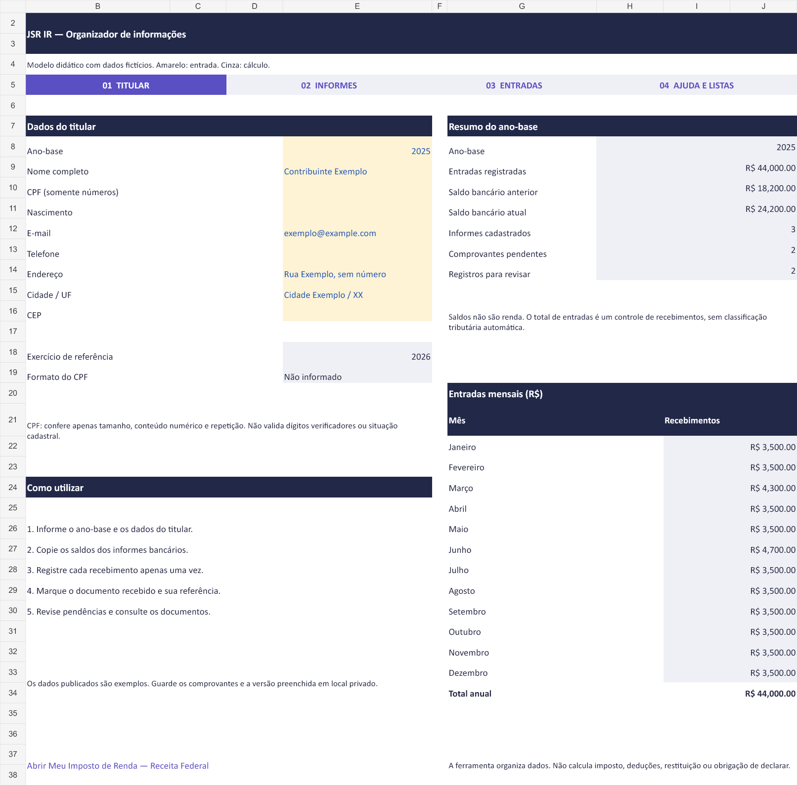
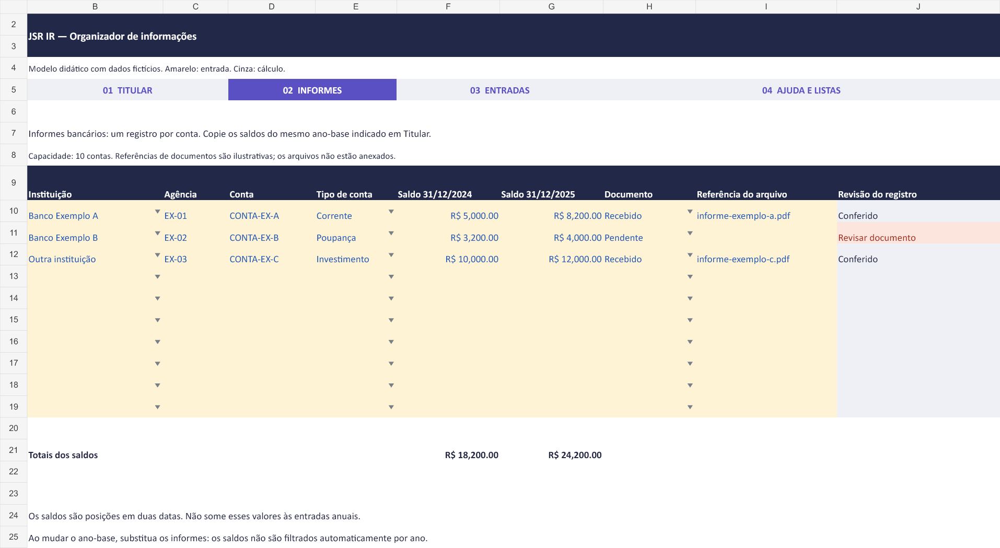
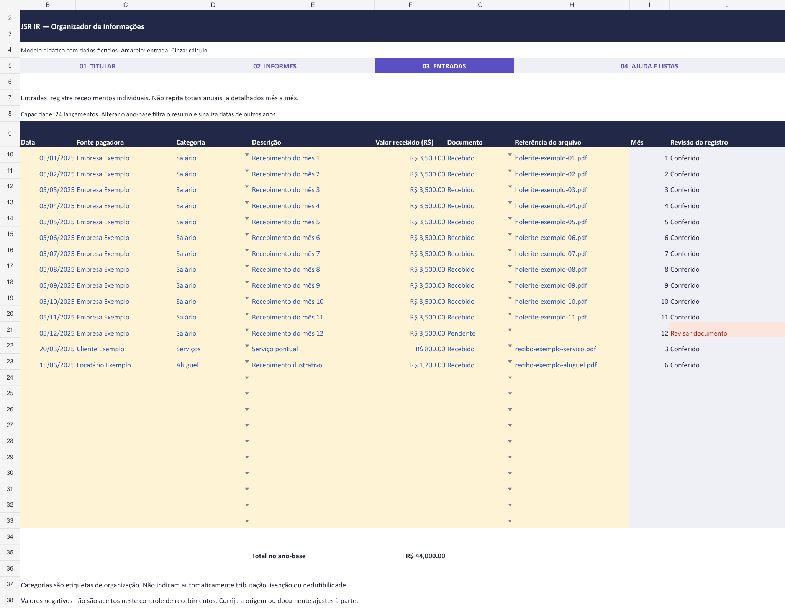
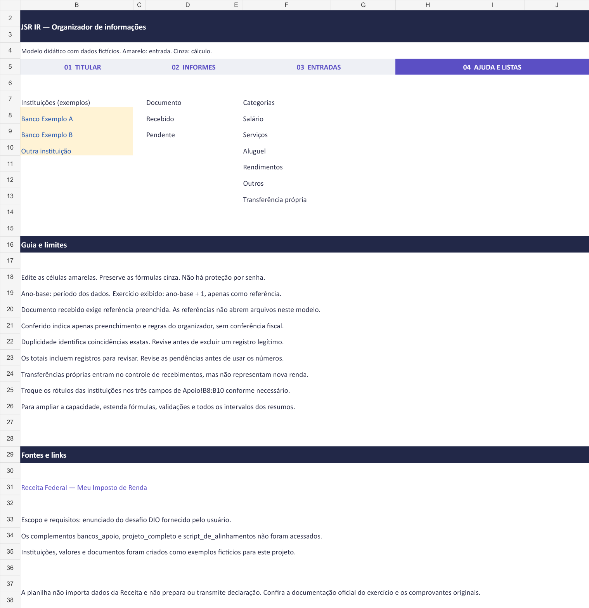

# JSR IR — Organizador de informações para Imposto de Renda

Ferramenta educacional no Excel desenvolvida a partir do enunciado do desafio da DIO. Reúne dados do titular, saldos de informes bancários e recebimentos, com navegação entre abas, listas suspensas e alertas de preenchimento.

O projeto organiza informações para consulta e revisão. Não calcula imposto, restituição, deduções, obrigação de declarar ou enquadramento tributário. Não transmite declarações nem se conecta à Receita Federal.

## Arquivos

```text
organizador-imposto-de-renda.xlsx
README.md
DESCRICAO.md
images/
  01-titular.png
  02-informes.png
  03-entradas.png
  04-apoio.png
```

Abra o arquivo XLSX no Microsoft Excel. O modelo não usa macros, suplementos ou conexões externas de dados. Os menus são hiperlinks internos; o acesso à página da Receita é um hiperlink externo.

## O que a ferramenta permite responder

| Pergunta | Local |
| --- | --- |
| Qual é o ano-base e quem é o titular? | Titular!E8:E16 |
| Qual foi o total de recebimentos registrados no ano? | Titular!H9 e I34 |
| Quanto foi registrado em cada mês? | Titular!G22:J33 |
| Quais são os saldos bancários anterior e atual? | Informes!F10:G19 e resumo em Titular!H10:H11 |
| Quantos comprovantes estão pendentes? | Titular!H13 |
| Quais registros precisam de revisão? | Coluna J de Informes e Entradas; contagem em Titular!H14 |

Os saldos são posições em datas específicas e ficam separados do total de recebimentos. O resumo não soma saldo bancário e entrada de dinheiro como se fossem a mesma grandeza.

## Como utilizar

1. Em **Titular**, escolha o ano-base e preencha os dados amarelos. O exercício exibido é o ano-base mais um, como referência de organização.
2. Em **Informes**, registre uma conta por linha, com instituição, agência, conta, tipo, saldos e situação do documento.
3. Em **Entradas**, registre os recebimentos individuais com data, origem, categoria, descrição e valor. Não repita um total anual se os recebimentos mensais já estiverem detalhados.
4. Marque o comprovante como `Recebido` ou `Pendente`. Quando recebido, informe a referência do documento.
5. Revise os registros sinalizados e confira as informações com os documentos originais.

**Amarelo** identifica entrada de dados. **Cinza** identifica fórmulas. As fórmulas não estão bloqueadas por senha, para permitir estudo e adaptação. As guias permanecem visíveis como alternativa aos menus.

## Estrutura

### Titular

Cadastro com nome, ano-base, CPF, nascimento, contato e endereço. Traz resumo dos recebimentos, saldos, documentos pendentes e lançamentos para revisar, além dos totais mensais.

CPF, nascimento, telefone e CEP estão vazios no exemplo público. O nome e o endereço são fictícios, e o e-mail usa o domínio reservado `example.com`.

### Informes

Capacidade inicial de **10 contas**, nas linhas 10 a 19. Os dois saldos devem vir dos informes referentes ao ano-base selecionado. Ao alterar o ano-base, substitua os informes: os saldos não são filtrados por ano automaticamente.

Os nomes das instituições são fictícios. Eles podem ser substituídos em **Apoio!B8:B10**. Se a instituição já estiver selecionada em uma conta, atualize também esse registro após renomear a opção.

### Entradas

Capacidade inicial de **24 recebimentos**, nas linhas 10 a 33. Os totais mensal e anual consideram as datas do ano-base escolhido.

As categorias são etiquetas de organização: Salário, Serviços, Aluguel, Rendimentos, Outros e Transferência própria. Elas não determinam automaticamente tributação ou isenção. Transferências próprias entram no controle de recebimentos se forem registradas, mas não representam nova renda.

### Apoio

Concentra as listas de instituições, documentos e categorias, instruções de uso e links. As listas são usadas na validação dos campos por intervalos nomeados.

## Validações e verificações automáticas

| Controle | Comportamento |
| --- | --- |
| Ano-base | Número inteiro entre 2000 e 2100 |
| Nascimento | Data entre 01/01/1900 e o fim do ano-base |
| Data do recebimento | Data dentro do ano-base selecionado |
| Valores monetários | Números de zero até R$ 1 trilhão, limite técnico do modelo |
| Instituição, categoria, tipo de conta e documento | Listas suspensas |
| Campos obrigatórios de um registro iniciado | Sinalização `Revisar dados` |
| Documento pendente | Sinalização `Revisar documento` |
| Documento recebido sem referência | Sinalização `Revisar referência` |
| Data de outro ano | Sinalização `Revisar ano-base` |
| Conta ou recebimento repetido | Sinalização `Revisar duplicidade` |
| CPF | Verificação básica de formato; não valida dígitos verificadores nem situação cadastral |

Nas contas, a chave de duplicidade usa instituição, agência e conta. Nas entradas, compara data, fonte, categoria, descrição e valor. Coincidências podem ser legítimas: o alerta pede revisão, sem excluir registros.

`Conferido` indica que as regras de preenchimento do organizador foram atendidas. Não significa que a informação foi auditada ou conferida pela Receita.

O resumo mantém separados **comprovantes pendentes** e **registros para revisar**. Um documento marcado como recebido, mas sem referência, deixa de ser pendente e continua exigindo revisão. As contagens não medem o preenchimento dos dados opcionais do titular.

Os totais incluem registros que precisam de revisão quando suas datas e valores permitem somar. Lançamentos com datas fora do ano-base não entram nos totais anuais e mensais. A lista de revisões deve ser conferida antes de utilizar os números. Colagens e alterações diretas podem contornar a validação de entrada do Excel.

## Fórmulas e conceitos demonstrados

- **SOMASES**: soma os valores entre o primeiro dia do ano e o primeiro dia do ano seguinte, sem incluir este último. O mesmo princípio separa os meses.
- **SOMA**: totaliza as posições bancárias e reconcilia os recebimentos mensais.
- **CONT.SES**: identifica duplicidades e conta pendências por critérios explícitos.
- **SE, OU, E, ÉNÚM, NÚM.CARACT e SEERRO**: verificam condições de preenchimento e formato.
- **DATA e MÊS**: definem limites de período e extraem o mês dos lançamentos.
- **Validação de dados**: restringe datas, números e opções selecionáveis.
- **Formatação condicional**: destaca os registros que precisam de revisão.
- **Hiperlinks internos e externos**: fazem a navegação e o acesso rápido à fonte oficial.

Exemplo da soma anual, em Excel em português:

```excel
=SOMASES(Entradas!$F$10:$F$33;Entradas!$B$10:$B$33;">="&DATA(ano_base;1;1);Entradas!$B$10:$B$33;"<"&DATA(ano_base+1;1;1))
```

O primeiro dia do ano seguinte é usado como limite exclusivo, incluindo todo o dia 31 de dezembro do ano-base. As referências absolutas preservam os intervalos ao copiar fórmulas.

O formato XLSX armazena funções em inglês; o Excel apresenta os nomes e separadores conforme o idioma da instalação.

## Intervalos nomeados

| Nome | Referência | Utilização |
| --- | --- | --- |
| ano_base | Titular!E8 | Datas, resumos e cabeçalhos |
| nome_titular | Titular!E9 | Identificação acessível por nome |
| cpf_titular | Titular!E10 | Verificação básica do CPF |
| lista_bancos | Apoio!B8:B10 | Lista de instituições e conferência dos registros |
| lista_documentos | Apoio!D8:D9 | Situação do comprovante |
| lista_categorias | Apoio!F8:F13 | Categorias das entradas e conferência dos registros |

## Dados de exemplo e resultados esperados

O exemplo usa o ano-base **2025** e exercício de referência **2026**. Esses anos identificam os dados fictícios e não representam a implementação de regras fiscais específicas.

| Indicador | Resultado esperado |
| --- | ---: |
| Recebimentos de salários: 12 × R$ 3.500 | R$ 42.000,00 |
| Serviço pontual | R$ 800,00 |
| Recebimento de aluguel | R$ 1.200,00 |
| Total de entradas no ano-base | **R$ 44.000,00** |
| Saldo bancário anterior | R$ 18.200,00 |
| Saldo bancário atual | R$ 24.200,00 |
| Contas cadastradas | 3 |
| Comprovantes pendentes | 2 |
| Registros para revisar | 2 |

Os dois documentos pendentes foram deixados no exemplo para demonstrar os alertas. Os nomes de arquivos são referências fictícias. Os comprovantes não estão anexados ao projeto e os campos de referência não são links de abertura.

## Imagens da ferramenta

### Titular e resumo



### Informes bancários



### Entradas



### Apoio



As imagens foram renderizadas a partir do arquivo gerado para documentar a interface. Não são capturas do aplicativo Microsoft Excel.

## Verificações realizadas

- Recálculo das fórmulas e conferência dos totais com somas independentes dos valores de exemplo.
- Alteração temporária de um recebimento de R$ 3.500 para R$ 3.600, com aumento de R$ 100 no resumo.
- Alteração do ano-base para um ano sem lançamentos, resultando em total anual zero e sinalização das datas incompatíveis.
- Troca de documento recebido para pendente, com atualização da contagem.
- Referência removida de um documento recebido, mantendo o alerta de revisão.
- Inserção temporária de um lançamento duplicado, com identificação da coincidência.
- Comparação de valor zero válido com valor ausente.
- Teste de CPF com todos os caracteres iguais.
- Varredura de erros de fórmula, inspeção dos recursos nativos exportados e revisão visual das quatro abas.

Os testes temporários foram revertidos antes da entrega. Os hiperlinks foram incluídos como recursos nativos do XLSX porque o mecanismo de geração não calcula a função HIPERLINK. A abertura, os cliques e o bloqueio interativo das validações precisam ser conferidos no Microsoft Excel antes da submissão.

## Como ampliar

Para incluir mais contas ou recebimentos, estenda as linhas de entrada, as fórmulas da coluna de revisão e, nas entradas, a coluna de mês. Amplie também as validações, a formatação condicional e os intervalos das fórmulas de resumo, totais e duplicidade. A versão atual tem intervalos delimitados e não expande automaticamente.

Possíveis evoluções: controle de despesas com comprovantes, cadastro de dependentes, pesquisa por fonte pagadora e referências clicáveis a documentos guardados em uma pasta privada. Essas funcionalidades não estão implementadas nesta versão.

## Fontes e escopo do desafio

- Enunciado do desafio de organização de informações para Imposto de Renda da DIO, fornecido pelo usuário.
- [Receita Federal — Meu Imposto de Renda](https://www.gov.br/receitafederal/pt-br/assuntos/meu-imposto-de-renda), usada como destino do link rápido para orientações oficiais.
- Os complementos `script_de_alinhamentos`, `bancos_apoio` e `projeto_completo` informados no enunciado não ficaram acessíveis durante a construção. A ferramenta foi criada de forma independente; não foi comparada com o arquivo completo das aulas.

Os nomes de instituições, valores e documentos foram criados como exemplos didáticos. Não foi utilizada uma base oficial de bancos. O link sobre máquina virtual Azure presente no enunciado não foi usado, pois não é necessário para esta ferramenta Excel.

## Entrega no GitHub

Repositório público: [JuscelinoSR/organizador-ir-excel](https://github.com/JuscelinoSR/organizador-ir-excel).

Abra o XLSX no Excel e confira os menus, uma alteração de valor e as validações. Para entregar o desafio na DIO, envie o endereço deste repositório pelo botão **Entregar Projeto**, acompanhado da breve descrição em `DESCRICAO.md`.

O repositório contém apenas exemplos fictícios. A versão preenchida com documentos e dados reais deve permanecer privada.
